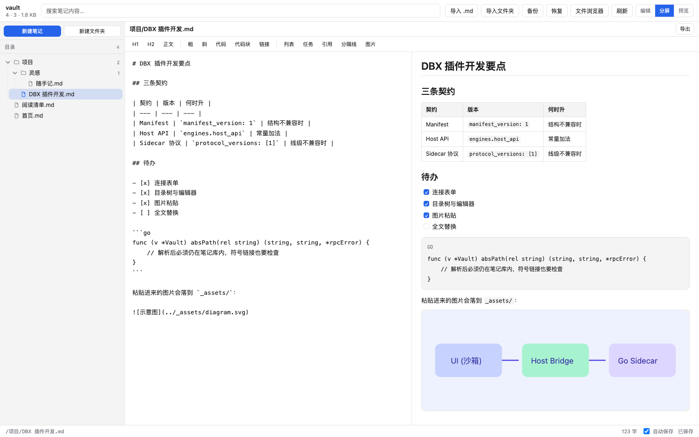
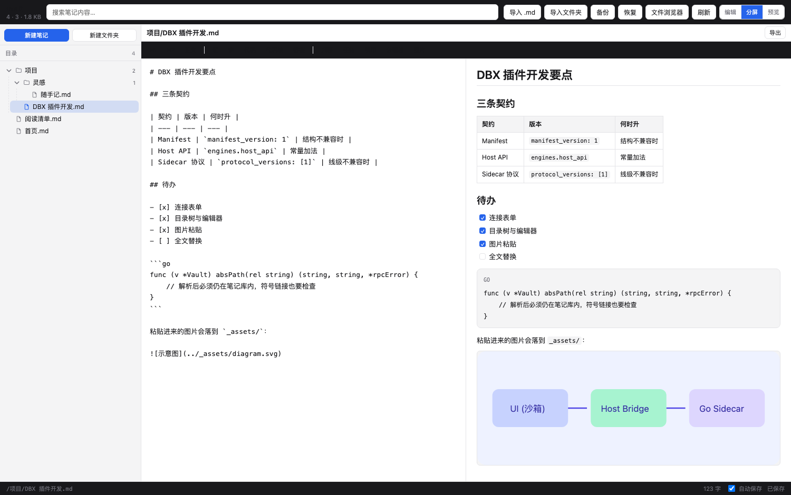
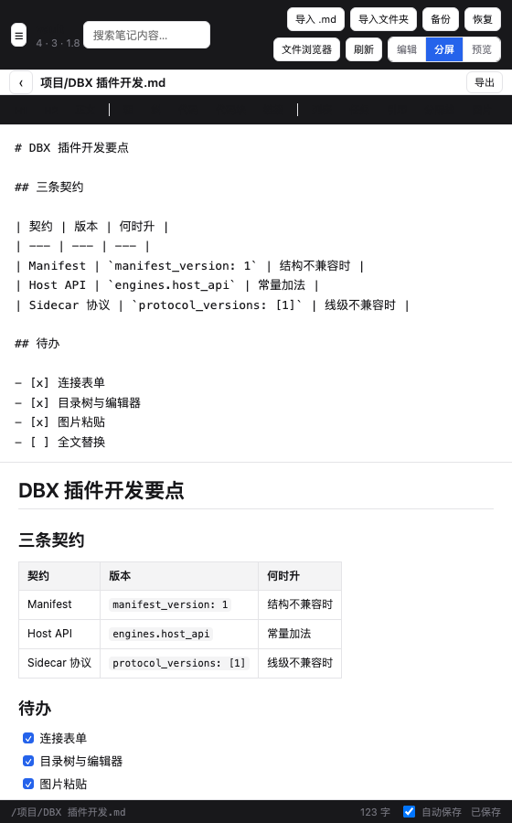

# MIKO.MD 笔记 —— DBX 插件

把**一个本地目录**变成 DBX 里的笔记库。笔记是磁盘上真实的 `.md` 文件，文件夹是真实的子目录；同一个库还能以 `mdnotes://vault/` 虚拟文件系统在 DBX 文件管理器里浏览。

- 插件 id：`miko.md.notes` ｜ 版本：`0.1.0` ｜ 作者：`miko` ｜ 仓库：<https://github.com/mikodream/miko-md-dbx>
- 平台契约：Manifest v1 + Host API 1.x + Sidecar 协议 v1
- 后端：Go 标准库（零第三方依赖），单进程 JSONL Sidecar
- 前端：静态 HTML/CSS/JS，无构建步骤、无网络、无外部资源



## 安装

```bash
dbx-plugin package . --target darwin-arm64     # 生成 dist/miko.md.notes-<版本>-darwin-arm64.dbxp
```

未签名开发包需要在 **DBX → 插件中心** 里显式打开「允许安装未签名开发包」，然后安装 `dist/` 下的 `.dbxp`。正式上架走 `t8y2/dbx-store` 审核签名（见文末）。

## 使用

1. **新建连接**：连接列表 → 新建 → 连接类型选「MIKO.MD 笔记」。
2. 填两个关键字段：
   - **笔记库目录**：本地目录的绝对路径（如 `~/Documents/notes`）。桌面端点右边的「选择目录」，也可以直接粘贴路径；目录不存在时点「创建目录」，会建好目录并写入一篇 `README.md`。
   - **图片目录**：粘贴/拖入图片的落点，默认 `_assets`。
   - **删除时移入 .trash**：默认开。关闭后删除是永久删除。
3. 保存连接 → 双击连接即打开笔记工作台。

### 工作台里能做什么

| 能力 | 说明 |
| --- | --- |
| 目录树 | 真实目录结构，树形展开即是导航（没有二级列表）；文件夹可折叠，打开笔记会自动展开到它 |
| 拖拽整理 | 抓任意笔记/文件夹拖动：落在文件夹中部＝移进它里面，落在行的上/下缘＝移到同级（父目录），落在树空白处＝移回根目录。拖动时目标文件夹有背景色，主色横条指示落点——同级占满整行，进文件夹则缩进一档 |
| 编辑 + 实时预览 | 编辑 / 分屏 / 预览三态；`Cmd/Ctrl+S` 保存，800ms 防抖自动保存可关 |
| Markdown | 标题、粗斜/删除线、行内代码、围栏代码块、引用、有序/无序/任务列表、表格、链接、图片 |
| 粘贴图片 | 编辑器里直接 `Cmd/Ctrl+V` 贴截图 → 落到图片目录 → 自动插入 `` |
| 拖入文件 | 拖 `.md` 进来即导入；拖**文件夹**进来保留子目录结构；拖图片进来即附件化 |
| 导入 | 单个/多个 `.md`；整个文件夹（拖入，或桌面端输入服务器绝对路径） |
| 导出 | 当前笔记导出为 `.md` 文件 |
| 备份/恢复 | 整库打包成 zip（流式分块，可取消），恢复时可选择目标子目录与是否覆盖同名 |
| 搜索 | 全库全文搜索，结果占用目录树位置，命中定位到行 |
| 文件浏览器 | 「在文件浏览器中打开」→ 以 `mdnotes://vault/` 浏览同一个库，可读写、改名、新建目录、删除 |
| 主题/语言 | 跟随 DBX 明暗主题与 `zh-CN`/`en` |





### mdnotes:// 虚拟文件系统

`filesystem-provider` 的根是 `mdnotes://vault/`，映射到笔记库目录：

- `filesystem/list` 分页列出（每页默认 200，上限 500）；
- `read` / `write` 内联上限 4 MiB，`etag` = `size-modifiedAt`；
- `createDirectory` / `rename` / `delete`（递归）；
- 隐藏项（`.obsidian`、`.trash`…）在文件浏览器里**照常显示**——这一层看的是真实目录；笔记树里才隐藏。

### 删除与回收站

开着 `.trash` 开关时，删除笔记/文件夹是移动到 `<库>/.trash/<时间戳>-<名字>`；关闭后是永久删除。备份默认不包含 `.trash`。

## 数据在哪

全部在你自己指定的目录里，插件不另存副本：

```
<笔记库>/
├── 首页.md
├── 项目/
│   ├── DBX 插件开发.md
│   └── 灵感/随手记.md
├── _assets/                    # 粘贴进来的图片
│   └── 20261125-210233-a1b2c3d4.png
└── .trash/                     # 删除的笔记（可手工找回）
```

插件自身的临时文件（备份 zip）写在 `DBX_PLUGIN_DATA_DIR`，用完即删。工作台的视图模式、上次打开的笔记存在 `host.storage`（`plugin-data/miko.md.notes/`）里。

## 权限

| 权限 | 为什么需要 |
| --- | --- |
| `host.workbench` | 改标签标题、打开文件系统入口 |
| `host.filesystem` | 「在文件浏览器中打开」 |
| `host.storage` | 记住视图模式与上次打开的笔记 |

不申请网络权限（UI 完全不联网）、不申请剪贴板读取（粘贴走编辑器事件）、不申请数据库查询/计划/元数据权限。文件读写由 Sidecar 直接做，不经 Host 权限面。

## 改了代码，为什么装上还是旧页面

DBX 的安装是**按 id + version 记账**的：

```
~/Library/Application Support/com.dbx.app/plugins/miko.md.notes/
├── versions/<版本>/…     # 已安装版本，不可变
└── activations/…json     # 激活记录：指向当前用哪个版本
```

同一个版本再装一次不会覆盖 `versions/<版本>/` 里的字节，所以页面还是旧的（本机实测：已装 `ui/app.js` 64176 字节＝三栏旧版，新包 63687 字节＝两栏版，版本号一样就被忽略了）。

三个可选做法，按迭代频率选：

| 场景 | 做法 |
| --- | --- |
| 调 UI / 边改边看 | `dbx-plugin dev --path . --port 5190`。开发宿主直接从磁盘读 `ui/`，刷新页面就是最新代码，**不安装、不占版本号** |
| 要在真 DBX 里验证 | `./dev/release.sh`（薄包装，实现是 skill 里的 `bump-release.sh`）：自动把 `manifest.json` 与 `backend/main.go` 的版本一起 +1，构建、跑协议冒烟、打包，一条命令 |
| 临时救急 | 插件中心里先**卸载**再装同一个版本（同版本不可覆盖，卸载后就干净了） |

`dev/release.sh` 的选项：`--minor`、`--major`、`--set 0.2.0`、`--target <三元组>`、`--no-test`。版本号只升不降，DBX 会保留旧版本目录，随时能回滚。

不要指望 `0.1.0+build.7` 这种构建元数据来省版本号：SemVer 规定构建元数据不参与优先级比较，DBX 用同一套比较时可能仍视作同一版本，这条路没验证过。

## 开发

```bash
# 后端
cd backend && go build -o ../bin/miko-md-notes .   # go vet / gofmt 见下
gofmt -l . && go vet ./...

# 契约级冒烟（82 项断言：生命周期、CRUD、图片、导入、备份/恢复、mdnotes://）
python3 dev/smoke.py --binary bin/miko-md-notes

# UI × 后端端到端（jsdom 冒充 DBX 宿主；需 cd dev && npm install）
node dev/ui-test.mjs            # 60 项：启动、目录树、打开/Ctrl+S、拖拽移动、粘贴图片、XSS、openFilesystem
node dev/ui-test-noconn.mjs     # 5 项：没有 connectionId 时的降级提示
node dev/ui-test-lastnote.mjs   # 5 项：回到上次打开的笔记

# manifest 离线校验（可选：没装 dbx-plugin-dev skill 时跳过，打包本身也会校验）
python3 "${DBX_SKILL:-$HOME/.agents/skills/dbx-plugin-dev}/scripts/check_manifest.py" . 2>/dev/null || \
  echo "跳过 manifest 校验（未找到 check_manifest.py）"

# 本地开发宿主（浏览器里看真 UI，连真后端）
dbx-plugin dev --path . --port 5190

# 打包
dbx-plugin package . --target darwin-arm64
```

验证现状：协议冒烟 82 项、UI 端到端 60 + 5 + 5 项、manifest 校验 0 error，全部通过。

`dev/SPEC.md` 是后端与 UI 之间的唯一契约（36 个 RPC 方法、错误码前缀、路径规则、UI 行为要求）。两份实现都不许偏离它。

### 目录结构

```
.
├── manifest.json          # 连接类型 / 工作台 / mdnotes:// 三个贡献点
├── dbx-plugin.toml        # 打包清单与 Go 后端声明
├── assets/                # 插件与连接图标
├── ui/                    # 沙箱工作台（index.html / app.js / markdown.js / style.css）
├── backend/               # Go Sidecar（main.go / vault.go / archive.go）
├── dev/                   # SPEC.md、协议冒烟、UI 端到端、发布脚本（不打包）
├── docs/                  # 截图（不打包）
└── dist/                  # 构建产物（不提交）
```

打包只收 `assets/`、`ui/` 与编译后的后端二进制；`dev/`、`docs/`、`dist/`、`.dbx-dev/` 都不进包。

### 设计上刻意做的几件事

- **笔记树不等于目录树**：笔记树只显示笔记与文件夹；图片、附件、`_assets` 交给 `mdnotes://`。否则每个附件都会变成树上的一行噪音。
- **图片路径相对笔记所在目录**：`notes/saveImage` 返回的 `markdown` 与预览解析用的是同一套相对路径规则，跨目录粘贴不会写坏链接。
- **路径安全两道闸**：词法检查（拒绝 `..`、绝对路径、反斜杠、NUL）+ 符号链接解析后仍在库内，越界一律 `PATH_OUTSIDE_VAULT`。
- **写入原子化**：临时文件 + `rename` 覆盖，保留原权限位；带 `expectedModifiedAt` 时检测外部改动并报 `CONFLICT`。
- **备份不写进库**：zip 落在插件数据目录，分块读给宿主保存，避免把大文件塞进单条 8 MiB 消息。

## 自动发布（GitHub Actions）

`.github/workflows/release.yml` 在 **main 每次更新**时自动走完官方流程的第一步：

1. 读 `manifest.json` 的版本；若该版本已发过（tag 已存在），自动 patch +1 并提交
   `chore(release): vX [skip ci]`（同时改 `backend/main.go` 的 `pluginVersion`，两处必须一致）；
2. 打 tag `v<version>`；
3. 按平台矩阵构建**未签名**候选包（target 必须等于构建主机，所以一平台一台 runner）：

   | runner | target |
   | --- | --- |
   | `macos-15` | `darwin-arm64` |
   | `macos-15-intel` | `darwin-x64` |
   | `ubuntu-24.04` | `linux-x64` |
   | `ubuntu-24.04-arm` | `linux-arm64` |
   | `windows-2022` | `windows-x64` |

4. 汇总并发布 GitHub Release，资产包含：
   - 每个平台的 `<id>-<version>-<target>.dbxp`
   - 每个包对应的 `<id>-<version>-<target>.artifact.json`
   - `release-candidates.json`（`{ plugin: {id,name,description,publisher,version,permissions}, artifacts: [{target,url,sha256,size}] }`，`dbx-store` 的 `sync-release-candidate.mjs` 直接读这个结构）
   - Release Notes（含平台表、SHA-256 校验清单、本次提交列表）与源码 tag

商店展示信息写在仓库根的 `.dbx-store.json`（由 `dbx-store` 的同步任务在对应 tag 下抓取）：

| 字段 | 说明 |
| --- | --- |
| `name` / `description` | 商店里的标题与介绍（默认语言） |
| `icon` | 包内相对路径（同步时转成 tag 下的 raw URL）或 http(s) 绝对地址 |
| `tags` | 分类标签，不重复字符串数组 |
| `source` / `homepage` | 源码与主页 |
| `license` | 许可证标识，需与仓库 `LICENSE` 一致 |
| `releaseNotes` | 商店展示的版本说明（跨版本沿用，别写死版本号） |
| `localizations` | 按 locale 覆盖，每项只允许 `{ name, description }`；商店会对缺 `zh-CN`、以及中文正文缺 `en` 打警告 |

只认这些字段，多一个都会被拒。本地校验：

```bash
node dev/ci/check-store-metadata.mjs
```

许可证：[Apache-2.0](LICENSE)。

本地也能跑同一套汇总，用来验证产物：

```bash
node dev/ci/make-release-candidates.mjs dist   # 目录里放 *.dbxp 与 *.artifact.json
```

脚本会按官方规则校验：target 唯一、SHA-256/大小与包字节一致、包内没有 `signature.json`（必须未签名）、各平台 manifest 身份完全一致、元数据里不许有 `signingKeyId`。

手动补发一次：Actions → Release → Run workflow，可填 `version` 指定版本号。商店侧只需把本仓库登记到 `dbx-store/automation/plugin-sources.json`（`autoUpdate: true`），它会自行拉 `release-candidates.json` 建候选 PR。

## 发布到官方商店

作者不持私钥、不跑 `keygen`、不填 `signingKeyId`。流程：自己的仓库打 Tag 发候选 Release（含未签名 `.dbxp` + `.artifact.json` + `release-candidates.json`）→ `dbx-store` 同步 Workflow 建候选 PR → 维护者审核并签名 → 合并。每一步版本号必须递增，已发布资产不可覆盖。

细节见 DBX 官方文档：<https://dbxio.com/cn/docs/plugin-development>。
